<a href="https://www.mnakhae.ir">
  
</a>

  &nbsp;
  &nbsp;
  &nbsp;
  

 

<picture>
  <source media="(prefers-color-scheme: dark)" srcset="./assets/sections/about-dark.svg">
  
</picture>



  

<picture>
  <source media="(prefers-color-scheme: dark)" srcset="./assets/sections/shipped-dark.svg">
  
</picture>

  <a href="https://gamelinee.ir"></a>
  <a href="https://nibolingo.com"></a>

  <a href="https://matteocomedy.com"></a>
  <a href="https://beenb.ir"></a>

  <a href="https://hypersadra.mnakhae.ir"></a>
  <a href="https://rosephoto.art"></a>

  <a href="https://vasset.ir"></a>
  <a href="https://ca.mnakhae.ir"></a>

<b>&nbsp;+ 9 more shipped projects</b>

 

| Project | What it is | Built with |
| :-- | :-- | :-- |
| [**Elahi Finance**](https://elahi.finance) | A modern finance & investment platform | Next.js · NestJS · TypeScript |
| [**CCRU**](https://ccru.ir) | The Cybernetic Culture Research Unit archive, in Persian | Next.js · NestJS · PostgreSQL · GSAP |
| [**DaGallery**](https://dagallery.mnakhae.ir) | A portfolio platform where artists showcase their life's work | Next.js · GSAP · TypeScript |
| [**Cheghadr**](https://cheghadr.mnakhae.ir) | Real-time cost & delivery estimates for digital projects | Next.js · TypeScript |
| [**Luné**](https://lune-phi.vercel.app) | An e-commerce storefront for minimal, luxury jewellery | Next.js · Tailwind CSS |
| [**OLTS**](https://OLTS.space) | Scheduling, reminders and earnings for teams of online teachers | Next.js · NestJS · TypeScript |
| [**Bechinim**](https://t.me/BechinimBot) | A Telegram mini-app that crafts romantic notes for someone you love | Telegram Mini App · TypeScript |
| [**Professor Analysis**](https://t.me/OstadshenasiTJ_bot) | A Telegram bot for looking up university professors | Telegram Bot · Python |
| [**mnakhae.ir**](https://www.mnakhae.ir) | My animated, 3D portfolio with its own CMS | Next.js · Three.js · PostgreSQL |

 

<picture>
  <source media="(prefers-color-scheme: dark)" srcset="./assets/sections/stack-dark.svg">
  
</picture>

  <code>&nbsp;LANGUAGES&nbsp;</code>  
  

  <code>&nbsp;FRONTEND&nbsp;</code>  
  

  <code>&nbsp;BACKEND&nbsp;</code>  
  

  <code>&nbsp;AI &amp; DATA&nbsp;</code>  
  

  <code>&nbsp;INFRA &amp; DEVOPS&nbsp;</code>  
  

 

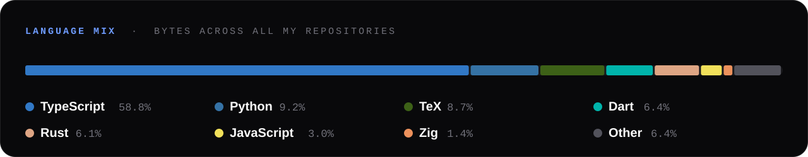

  

<picture>
  <source media="(prefers-color-scheme: dark)" srcset="./assets/sections/journey-dark.svg">
  
</picture>


  

<picture>
  <source media="(prefers-color-scheme: dark)" srcset="./assets/sections/writing-dark.svg">
  
</picture>

- **[From Physics to Code: My Journey into Software Development](https://www.mnakhae.ir/blog/from-physics-to-code)**  `CAREER` · Nov 2024
- **[AI Integration Patterns in Modern Web Applications](https://www.mnakhae.ir/blog/ai-integration-modern-web-apps)**  `AI & ML` · Dec 2024
- **[Building a 3D Portfolio with Three.js and Next.js](https://www.mnakhae.ir/blog/building-3d-portfolio-threejs-nextjs)**  `WEB` · Dec 2024
- **[NestJS vs Laravel: A Backend Framework Comparison](https://www.mnakhae.ir/blog/nestjs-vs-laravel-backend-comparison)**  `BACKEND` · Nov 2024

 

<a href="https://t.me/MNakhaeiR">
  
</a>

  <a href="./frontend.pdf">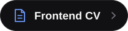</a>&nbsp;
  <a href="./backend.pdf">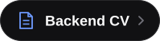</a>&nbsp;
  <a href="./ai-and-data-science.pdf">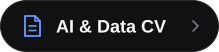</a>

The banner, cards and charts are hand-written animated SVG, generated by <a href="./scripts/build.py"><code>scripts/build.py</code></a>.

